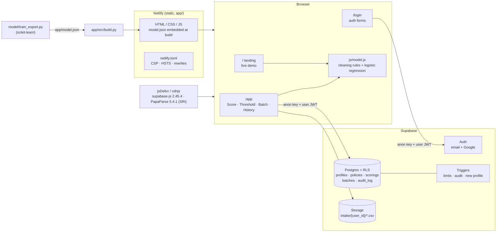

# Triage: credit pre-screening

Triage takes clear-cut personal-loan declines out of the manual review queue, so credit analysts spend their 25 minutes per file on applications that need judgement. **The model never approves.** Every application lands in one of three lanes:

| Lane | When |
|---|---|
| **Auto-decline** | decline confidence ≥ the policy threshold (default 0.90) **and** the applicant has a bureau score |
| **Analyst review** | everything else |
| **Analyst only** | applicants with no credit history, when the policy routes them to analysts (the default) |

At the default 0.90 threshold, on 2,400 held-out applications scaled to 3,000 a month: **441 applications** a month auto-declined · **184 analyst hours** freed · **3.1%** of auto-declines were people the bank approved (its limit is 5%).

**Live:** https://triagecreditscreener.netlify.app

Coursework for Calibo AI Academy MUC02 · Batch 10 · Path 2, KLU. A sibling of [Clarity](https://clarityeda.netlify.app).

## What's in it

- **Landing** (`/`): what Triage does, the 0.90 / 5% rule in three numbers, a live demo that scores one example application in place, how it works, limitations.
- **Sign in** (`/login`): email + password, create account, forgot / reset password, Google sign-in. Signed-in visitors go straight to the app.
- **App** (`/app`, signed-in only):
  - **Score**: one application → lane, confidence, ratios, the factors that moved the score. *Save to history* with an optional note.
  - **Threshold**: the trade-off explorer and fairness monitor. *Save as my policy* stores your threshold and new-to-credit routing; Score and Batch then use it.
  - **Batch**: upload an intake CSV. It is scored in the browser, stored privately in your Storage folder, and the summary is saved as a batch record. Download the scored CSV.
  - **Report**: a Clarity-style report for the current batch. A visual summary first (KPIs, the 5% rule, lanes, confidence histogram, key findings), then a numbered analyst report (policy, data checks, lane outcomes, check against the bank's decisions, fairness, employment types, top declines, recommendations, limitations). Export as Markdown, visual HTML, Print / PDF, or the scored CSV. Saved batches get a **Report** button in History.
  - **History**: your saved scorings and batches. Search, re-open, delete.
  - **About the model**: the model card.
  - **Account menu**: email, sign out, delete account (with an inline type-DELETE confirmation).
- **404** page in the same style.

Limits, enforced in the database: **50 saved scorings** and **5 batches** per user ("Delete one to save another").

## Architecture



- **No server of our own.** The pages are static. Scoring runs in the browser from `app/js/model.js`. Supabase holds accounts and saved work.
- **Only the anon key is in the client** (`app/config.js`). It is public by design: row-level security decides what each signed-in user can read or write. The service-role key is never used.
- **One scorer.** `app/js/model.js` is loaded by the pages and by `tests/parity.mjs`, which checks it against scikit-learn on 300 test rows.

## Setup

### 1. Supabase

1. Create a project at [supabase.com](https://supabase.com).
2. **SQL Editor → New query**: paste all of [`supabase/schema.sql`](supabase/schema.sql) and run it. It is idempotent, so re-running it after edits is safe and never drops data. It creates the tables, row-level security, limit and audit triggers, the `delete_account()` function and the private `intake` Storage bucket with per-user folder policies.
3. **Authentication → Sign In / Providers → Google**: enable it, paste a Google OAuth client ID and secret, and add the callback URL Supabase shows there to the client's *Authorised redirect URIs* in Google Cloud Console.
4. **Authentication → URL Configuration**:
   - **Site URL**: `https://triagecreditscreener.netlify.app`
   - **Redirect URLs**: `https://triagecreditscreener.netlify.app/**` (sign-up confirmation, password reset and Google all return to `/app` or `/login`). Add `http://127.0.0.1:4173/**` to test locally.

### 2. Config

`app/config.js` holds the project URL and the **anon public** key (Project Settings → API). [`app/config.example.js`](app/config.example.js) is the template. If you change projects, also update the two Supabase URLs in the `Content-Security-Policy` line of [`netlify.toml`](netlify.toml).

### 3. Netlify

Add a new site → Import from Git → this repo. Leave the **build command blank** and set the **publish directory** to `app` (already set in `netlify.toml`). The built pages are committed, so Netlify serves them as they are.

### 4. Run locally

```bash
node tests/serve.mjs
```

Then open http://127.0.0.1:4173. This server applies `netlify.toml`'s rewrites and headers, CSP included, so local behaviour matches production.

## Retrain the model and rebuild the pages

```bash
pip install scikit-learn pandas numpy
python model/train_export.py && python app/src/build.py
node tests/parity.mjs
```

`train_export.py` reproduces the notebook pipeline from `data/MUC02_Credit_PreScreening_Dataset.csv` and writes `app/model.json` plus `model/parity_fixture.json`. `build.py` assembles `app/index.html`, `login.html`, `app.html` and `404.html` from the templates in `app/src/`. Edit the templates, not the built files. Commit the rebuilt pages.

Saved scorings and batches record the `model_version`. Re-opening one saved under an older model says so.

## Tests

| Command | What it checks |
|---|---|
| `node tests/parity.mjs` | The JS scorer matches scikit-learn's `predict_proba` within 1e-8 on all 300 fixture rows, plus the lane and cleaning rules. |
| `bash tests/db/run.sh` | Applies `schema.sql` twice to a throwaway local Postgres (15+) with a stand-in for Supabase's `auth` / `storage` schemas, then checks RLS isolation between two users, the 50 / 5 limits, the append-only audit log, storage folder rules and account deletion. |
| `npm install && npx playwright test` | Smoke tests at desktop and 360px. Signed out: landing, headers, login validation, redirects, 404, keyboard, theme. Signed in: score → save → History; batch upload of `app/sample_batch.csv` → lane counts. The signed-in tests need a test account: `TRIAGE_TEST_EMAIL` and `TRIAGE_TEST_PASSWORD` in the environment or a gitignored `.env`. They clean up after themselves. |

## Cleaning rules (applied to every input)

- Monthly income above ₹6,00,000 is treated as annual and divided by 12.
- Blank income is filled with the median for the employment type.
- Blank credit score means new to credit: `is_ntc = 1`, and the median score fills the gap only inside the model.

## Batch file format

Batch files need the same headers as `MUC02_Credit_PreScreening_Dataset.csv`. These 13 are required:
`age, employment_type, years_in_current_job, monthly_income, existing_emi, credit_score, num_active_loans, delinquencies_24m, loan_purpose, loan_amount, tenure_months, proposed_emi, city_tier`.
Optional `decision` and `gender` columns add the wrongly-declined and fairness checks. Extra columns are kept in the scored download. Files over 10 MB are refused.

## Limitations

- **It copies past decisions, not repayment.** The model learned what analysts decided. Any mistakes or bias in those decisions are built in. Link decisions to repayment outcomes before relying on it.
- **Weak for new-to-credit applicants.** It is right only 56.7% of the time without a bureau score (81.2% with one), so those applicants are never auto-declined.
- **One bank, six months, simulated data** (April–September 2026). Re-test on newer applications before any live use.
- **Fairness needs watching.** Gender is not an input, but income and job type can stand in for it. Report the fairness monitor monthly.
- **Only the bank's file format.** Other datasets are rejected by column name. Category values the model never saw (for example a new employment type) score as neutral, without a warning.
- **Coursework, not a lending system.** It makes no lending decision about real people.

## Project layout

```
app/                    published by Netlify
  index.html login.html app.html 404.html   built pages (from app/src)
  config.js config.example.js               Supabase URL + anon key
  model.json sample_batch.csv
  css/triage.css  js/{model,supa,theme,landing,login,app,report}.js
  src/                  page templates + build.py (not served)
model/train_export.py   retrain + export
model/parity_fixture.json
data/                   MUC02 dataset
supabase/schema.sql
tests/                  parity.mjs · db/ · e2e/ · serve.mjs
netlify.toml  playwright.config.mjs  package.json
```
